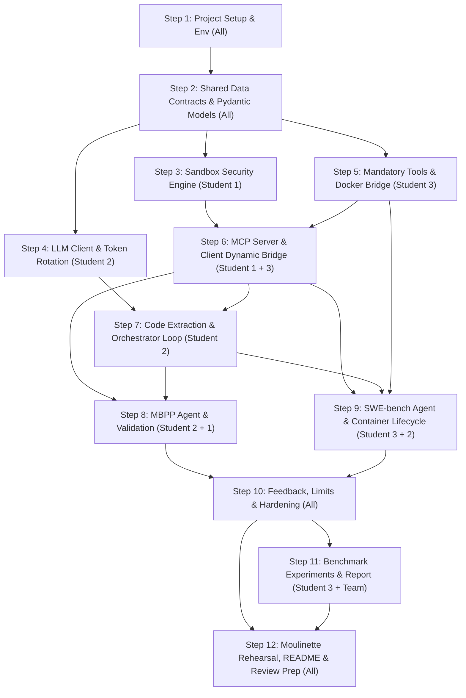

# Agent Smith - Project Implementation Plan & Team Roles

> **Project Reference**: *Agent Smith: Autonomous reasoning, code generation, and execution*  
> **Target Environment**: Python 3.10, `uv` package manager  
> **Team Size**: 3 Students  

---

## 1. Executive Summary & Objective

The objective of **Agent Smith** is to build an autonomous agentic framework capable of solving algorithmic problems (**MBPP**) and real-world repository bugs (**SWE-bench Verified**). Unlike classical prompt-response approaches, the agent operates via an iterative executable code loop:
$$\text{Thought} \longrightarrow \text{Code} \longrightarrow \text{Observation}$$

Key technical mandates:
- **Zero Third-Party Agent Frameworks**: No LangChain, LlamaIndex, Smolagents, CrewAI, AutoGen, or LangGraph. The orchestration loop must be custom-built.
- **Strict Sandbox Isolation**: Built exclusively with Python standard libraries (no `RestrictedPython`). Must enforce import allowlisting, file system isolation, RAM limits, execution timeouts, disabled networking, and restricted builtins.
- **Model Context Protocol (MCP)**: Dynamic tool discovery and execution via stdio and streamable HTTP transports.
- **Multi-Provider & Multi-Token Engine**: Free-tier API integration (Groq, OpenRouter, Gemini, Mistral, etc.) featuring token rotation and rate-limit resilience.
- **Comprehensive Evaluation Compliance**: Must pass automated exam scripts (`exam_sandbox.sh`, `exam_mbpp.sh`, `exam_swebench.sh`) and live peer review tests.

---

## 2. Team Structure & Student Roles

| Role | Student | Primary Domain | Core Focus |
| :--- | :--- | :--- | :--- |
| **Student 1** | **Systems & Security Lead** | Sandbox, Isolation & MCP Protocol | Sandbox engine, standard library security guards, MCP client/server implementations, and Sandbox CLI. |
| **Student 2** | **Agent & Orchestration Lead** | LLM Engine, Prompting & MBPP | Custom loop orchestration, multi-format extraction, multi-token manager, prompt engineering, and MBPP agent. |
| **Student 3** | **SWE-bench & Benchmark Lead** | SWE-bench, Tools & Benchmarking | Docker integration, mandatory code navigation/diff tools, SWE-bench agent, model evaluation suite, and `BENCHMARK_REPORT.md`. |

---

### Detailed Responsibilities by Student

#### Student 1: Systems & Security Lead (Sandbox & MCP Architecture)
- **Sandbox Core (`sandbox/`)**:
  - Implement the isolated execution environment using `multiprocessing` / `subprocess`, `resource`, `signal`, and custom AST / builtin wrappers.
  - Implement allowlist-based import restrictions according to `SandboxConfig`.
  - Enforce file system boundary restrictions (`/testbed`, `/tmp/agent`).
  - Disable network sockets / network access completely within sandboxed code.
  - Enforce memory limit (`max_memory_mb: 512`) and execution timeout (`max_execution_time_seconds: 30`).
  - Inject built-in `final_answer(answer_string)` into the sandbox namespace (not an MCP tool).
  - Ensure critical control-flow exceptions (`KeyboardInterrupt`, `SystemExit`) bubble up cleanly.
- **MCP Infrastructure (`mcp/`)**:
  - Build MCP Client inside the sandbox that dynamically discovers tools, prompts, and resources from connected MCP servers.
  - Expose discovered MCP tools as standard callable Python functions in the sandbox namespace.
  - Implement MCP Server transports: both `stdio` and streamable `HTTP`.
  - Create root MCP server entrypoints: `mcp_tools_mbpp.py` and `mcp_tools_swebench.py`.
  - Ensure the sandbox dynamically adapts to unknown MCP servers at evaluation time.
- **Sandbox CLI & Documentation Generator**:
  - Implement CLI commands: `uv run sandbox`, `uv run sandbox --mcp-stdio ...`, `uv run sandbox --mcp-server ...`.
  - Implement dynamic sandbox manual generator (reads MCP tool schemas and builds system prompt tool documentation).

#### Student 2: Agent & Orchestration Lead (Loop, LLM Provider & MBPP)
- **LLM Engine (`llm/`)**:
  - Implement an abstract LLM interface supporting OpenAI-compatible APIs (OpenRouter, Groq, Together, Gemini AI Studio, Mistral, etc.).
  - Implement **Multi-Token Rotation**: manage pools of free-tier API keys per provider, handle HTTP 429 / quota errors gracefully, and rotate keys seamlessly.
  - Implement stop sequences (`<end_code>`, `</tool_call>`, etc.) to prevent output hallucination.
  - Implement telemetry and token tracking (input tokens, output tokens, latency, retries, requests).
- **Code Extraction Layer (`agent/extraction.py`)**:
  - Support Python code blocks (` ```python ... ``` `), Anthropic XML (`<invoke>`), JSON/Hermes (`<tool_call>`), and ReAct (`Action: ... / Action Input: ...`).
  - Convert all non-Python formats into equivalent executable Python function calls before sandbox invocation.
  - Provide explicit error diagnostics to the LLM when responses are malformed or missing code blocks.
- **Agent Orchestrator & MBPP Pipeline (`agent/`, `agent_mbpp.py`)**:
  - Implement the core autonomous loop: `Thought -> Code -> Observation -> Repeat`.
  - Implement `MBPPTaskInput`, `StepMetrics`, and `SolutionOutput` Pydantic models strictly adhering to the specification.
  - Design the base system prompt (methodology, formatting rules, tool manuals, and few-shot examples).
  - Implement `uv run python -m agent_mbpp --task-file ... --output ... --model-name ... --provider-url ...`.
  - Ensure compliance with MBPP limits (<= 10 iterations, <= 6,000 input tokens, <= 1,500 output tokens, <= 120s timeout).

#### Student 3: SWE-bench & Benchmark Lead (Tools, Docker & Benchmark Report)
- **Mandatory Toolset (`tools/`)**:
  - File System Tools: `read_file(filepath, start_line, end_line)` (with `cat -n` format), `edit_file(filepath, old_str, new_str)`, `list_files(directory, pattern)`.
  - Code Search Tools: `search_code(pattern, file_pattern)`, `search_function_or_class_definition_in_code(name)`, `find_references(name, filepath, line)` (all using standard format `/path:line content`).
  - Execution Tools: `run_tests()`, `get_patch()` (`git -c core.fileMode=false diff`), `run_command(command, workdir)`.
- **SWE-bench Integration & Docker (`docker/`, `agent_swebench.py`)**:
  - Manage Docker container lifecycle for SWE-bench instances (pulling image, running container, volume mounts, cleanup on exit/failure).
  - Bridge host sandbox with container tools (or containerized execution).
  - Implement `SWEBenchTaskInput` and wire SWE-bench CLI: `uv run python -m agent_swebench --task-file ... --output ...`.
  - Ensure compliance with SWE-bench limits (<= 30 iterations, <= 300,000 input tokens, <= 10,000 output tokens, <= 900s timeout).
- **Benchmarking & Documentation**:
  - Execute benchmark runs across $\ge 5$ models on $\ge 3$ SWE-bench tasks (save all backing `solution.json` files).
  - Measure exploratory metrics (step file first read/edited, test failure decrease step, test pass to final answer iterations).
  - Perform and document at least one prompt/parameter ablation study.
  - Write `BENCHMARK_REPORT.md` and co-author `README.md`.

---

## 3. Step-by-Step Implementation Roadmap



---

### Phase 1: Foundation & Specifications

#### Step 1: Project Bootstrap & Dependencies
- **Lead**: All
- **Actions**:
  - Initialize `pyproject.toml` with Python 3.10 and `uv`.
  - Configure dependencies: `pydantic>=2.0`, `httpx`, `mcp` (or standard MCP SDK), `pytest`, `python-dotenv`.
  - Define folder structure (`agent/`, `sandbox/`, `mcp_server/`, `tools/`, `llm/`, `benchmarks/`).
  - Create `.env.example` defining provider keys (`OPENROUTER_API_KEYS`, `GROQ_API_KEYS`, etc.).
- **Deliverables**: Verified `uv sync`, working test runner, clean repository skeleton.

#### Step 2: Shared Data Contracts & Pydantic Models
- **Lead**: Student 2 (Review: Students 1 & 3)
- **Actions**:
  - Define models in `schemas.py`:
    - `SandboxConfig` (authorized_imports, allowed_directories, max_execution_time_seconds, max_memory_mb).
    - `MBPPTaskInput` (task_id, task_definition, function_definition, test_imports, test_list).
    - `SWEBenchTaskInput` (instance_id, problem_statement, docker_image, eval_script, hints_text, repo).
    - `StepMetrics` and `SolutionOutput` exactly matching Chapter V.3 & V.4 requirements.
- **Deliverables**: Shared Pydantic module imported by all submodules.

---

### Phase 2: Core Subsystems

#### Step 3: Sandbox Security & Execution Isolation
- **Lead**: Student 1
- **Actions**:
  - Build sandbox executor with sub-process isolation (`multiprocessing` / isolated runner).
  - Implement strict import hook / AST validator restricting imports exclusively to `authorized_imports`.
  - Override / disable dangerous builtins (`__import__`, `eval`, `exec`, `open` mapped only to allowed directories).
  - Disable network access (monkeypatch `socket` or isolate network namespace).
  - Set limits via `resource.setrlimit` (CPU time, virtual memory) and timeout guards (`signal.SIGALRM` or process timeout).
  - Implement built-in `final_answer(answer: str)` capturing output and signaling clean termination.
  - Ensure `KeyboardInterrupt` and `SystemExit` propagate without being suppressed.
  - Implement CLI entrypoint: `uv run sandbox [config.json]`.
- **Validation**: Verify against `exam_sandbox.sh` test scenarios.

#### Step 4: LLM Provider Client, Multi-Token Rotation & Telemetry
- **Lead**: Student 2
- **Actions**:
  - Implement `LLMProvider` abstraction supporting OpenRouter, Groq, Together, Gemini, etc.
  - Implement `TokenRotator`: parses comma-separated keys from environment variables (e.g. `OPENROUTER_API_KEY_1,OPENROUTER_API_KEY_2...`), tracks rate limits (HTTP 429), and automatically shifts to the next token with exponential backoff.
  - Add request telemetry: timing (`request_time_ms`), token counting (`input_tokens`, `output_tokens`), retry counting (`retries`).
  - Support stop tokens (e.g. `["<end_code>", "Observation:"]`).
- **Validation**: Unit tests verifying token rotation during simulated 429 errors.

#### Step 5: Mandatory Tools & Docker Bridge Implementation
- **Lead**: Student 3
- **Actions**:
  - Implement File System Tools:
    - `read_file(filepath, start_line, end_line)` formatting lines as `<line_number>: <line_content>`.
    - `edit_file(filepath, old_str, new_str)` ensuring exact single-occurrence replacement.
    - `list_files(directory, pattern)`.
  - Implement Code Search Tools:
    - `search_code(pattern, file_pattern)`.
    - `search_function_or_class_definition_in_code(name)`.
    - `find_references(name, filepath, line)` (using AST/jedi/grep matching format `/path:line content`).
  - Implement Execution Tools:
    - `run_command(command, workdir)`.
    - `get_patch()` executing `git -c core.fileMode=false diff`.
    - `run_tests()`.
  - Build Docker bridge for executing commands and tools inside the container.
- **Validation**: Comprehensive unit tests validating tool output formats.

#### Step 6: MCP Integration & Dynamic Tool Discovery
- **Lead**: Student 1 & Student 3
- **Actions**:
  - Implement MCP Servers: `mcp_tools_mbpp.py` and `mcp_tools_swebench.py` at repository root.
  - Expose tools over `stdio` and streamable `HTTP` transports.
  - Inside the sandbox, build MCP client that connects dynamically to the specified server, queries available tools, and injects callable Python wrappers into the sandbox namespace.
  - Implement dynamic sandbox manual generator: auto-generate tool signatures and docstrings from tool schemas into the agent prompt.
  - Test sandbox against an arbitrary, unknown mock MCP server.
- **Validation**: `uv run sandbox --mcp-stdio "python mcp_tools_mbpp.py"` successfully calls `run_tests()` from within the sandbox session.

---

### Phase 3: Agent Orchestration & Benchmark Pipelines

#### Step 7: Extraction Layer & Autonomous Orchestrator Loop
- **Lead**: Student 2
- **Actions**:
  - Implement `agent/loop.py`: central Thought $\rightarrow$ Code $\rightarrow$ Observation loop.
  - Implement extraction layer handling:
    - Python Markdown blocks (` ```python ... ``` `)
    - Anthropic XML (`<invoke name="..."><param>...</param></invoke>`)
    - Hermes JSON (`<tool_call>{"name": "...", "arguments": {...}}</tool_call>`)
    - ReAct (`Action: ... / Action Input: ...`)
  - Translate all formats into executable Python syntax for sandbox execution.
  - Handle malformed inputs, providing detailed sandbox feedback strings so the model can self-correct.
- **Deliverables**: End-to-end loop running mock tasks.

#### Step 8: MBPP Agent Implementation & Validation
- **Lead**: Student 2 (Supported by Student 1)
- **Actions**:
  - Implement `agent_mbpp.py` with CLI arguments:
    `uv run python -m agent_mbpp --task-file ... --output ... --model-name ... --provider-url ...`
  - Design MBPP system prompt teaching function signature synthesis, test execution, and invoking `final_answer(code)`.
  - Connect with `mcp_tools_mbpp.py` (exposing `run_tests`).
  - Test and tune prompts to respect MBPP limits (10 iterations, 6k input tokens, 1.5k output tokens, 120s timeout).
- **Validation**: Achieve $\ge 4/5$ passes on random MBPP tasks with `moulinette_eval validate mbpp`.

#### Step 9: SWE-bench Agent Implementation & Docker Container Workflow
- **Lead**: Student 3 (Supported by Student 2)
- **Actions**:
  - Implement `agent_swebench.py` with CLI arguments:
    `uv run python -m agent_swebench --task-file ... --output ... --model-name ... --provider-url ...`
  - Implement container management: pull SWE-bench Docker image, launch testbed, bridge tools, and ensure `docker rm -f` is executed in a `finally` block.
  - System prompt design: issue localization, reading stack traces, targeted search, editing files, running evaluation script, and invoking `final_answer(get_patch())`.
  - Validate on target benchmark tasks (e.g., `sympy__sympy-14711`, `sympy__sympy-13480`, `pydata__xarray-4629`).
- **Validation**: Achieve $\ge 2/3$ passes on SWE-bench tasks within limits (30 iterations, 300k input tokens, 10k output tokens, 900s timeout).

---

### Phase 4: Hardening, Benchmarking & Final Delivery

#### Step 10: Robustness, Error Handling & Constraint Enforcement
- **Lead**: All
- **Actions**:
  - Verify explicit feedback on: no code block found, malformed code, timeout hit, truncated output, syntax/lint errors.
  - Ensure zero crashes: catch and log all unhandled exceptions as `error` in `SolutionOutput`.
  - Enforce strict hard token and iteration stops across all loops.
  - Ensure absolute cleanliness: no hardcoded API keys in source code (load purely from env / `.env`).

#### Step 11: Benchmark Experiments & `BENCHMARK_REPORT.md`
- **Lead**: Student 3 (Team contributions)
- **Actions**:
  - Select $\ge 5$ models across providers (e.g. Qwen 2.5 Coder, DeepSeek V3/R1, Llama 3.3 70B, Mistral Small/Codestral, Gemini 1.5 Flash).
  - Run each on at least 3 identical SWE-bench tasks.
  - Save all resulting `solution.json` files in the repository.
  - Compute intermediary metrics:
    1. Step of first reading/editing patch file (exploration efficiency)
    2. Step test failures first decrease (partial progress)
    3. Iterations between test pass and `final_answer` (discipline)
  - Perform an ablation study (e.g. prompt style change, tool availability impact, or token budget variation).
  - Compile findings into `BENCHMARK_REPORT.md`.

#### Step 12: Final Review Preparation & Documentation
- **Lead**: All
- **Actions**:
  - Author `README.md` in English satisfying every specification from Chapter VII (required italicized first line with logins, system architecture, agent loop, sandbox design, tool details, and AI usage disclosure).
  - Rehearse `exam_sandbox.sh`, `exam_mbpp.sh`, and `exam_swebench.sh` end-to-end.
  - Conduct mock peer review: practice live 2-5 minute agent modifications on MBPP tasks (e.g. adding a custom logging field, tweaking prompt instructions) to ensure complete codebase fluency.

---

## 4. Key Constraints & Evaluation Checklist

| Checkpoint | Target / Constraint | Primary Owner |
| :--- | :--- | :--- |
| **Language & Tooling** | Python 3.10, managed via `uv` | Student 1 |
| **No Frameworks** | Pure custom agent loop (no LangChain, Smolagents, etc.) | Student 2 |
| **Sandbox Security** | Standard library only; import allowlist, no network, timeout, memory limit | Student 1 |
| **MCP Support** | Stdio & streamable HTTP transports; unknown server support | Student 1 & 3 |
| **API Management** | Free-tier only, multi-token rotation on 429/exhaustion | Student 2 |
| **MBPP Pass Criteria** | $\ge 4 / 5$ tasks pass (<= 10 iter, <= 6k in, <= 1.5k out, <= 120s) | Student 2 |
| **SWE-bench Pass Criteria**| $\ge 2 / 3$ tasks pass (<= 30 iter, <= 300k in, <= 10k out, <= 900s) | Student 3 |
| **Docker Cleanliness** | Automatic container cleanup on complete/crash | Student 3 |
| **Benchmark Report** | $\ge 5$ models $\times$ $\ge 3$ tasks, backing `solution.json` files, ablation | Student 3 |
| **README Compliance** | Required 42 header line, architecture, tools, AI usage disclosure | All |
