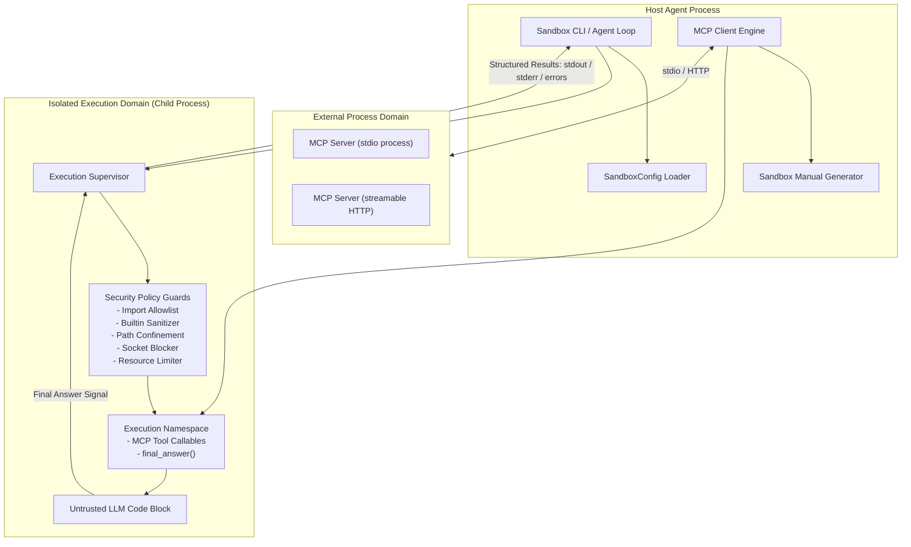
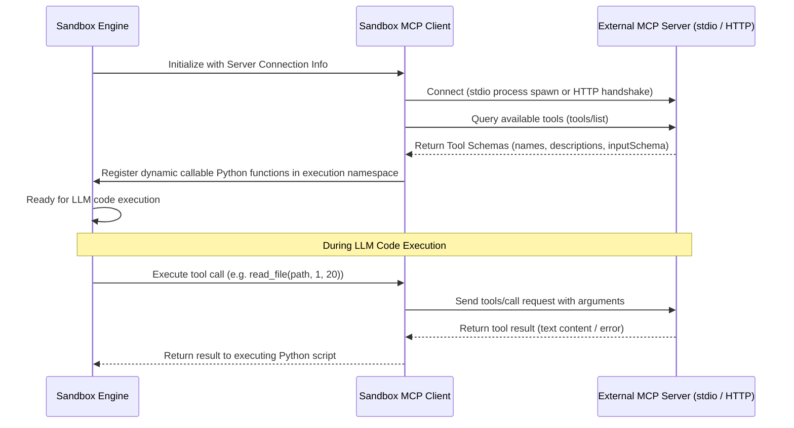

# Student 1: Systems & Security Lead Roadmap
## Sandbox Architecture, Isolation Enforcement & MCP Protocol

---

## 1. Executive Summary & Role Overview

As **Student 1 (Systems & Security Lead)**, you own the bedrock of the Agent Smith framework:
1. **The Sandbox Execution Boundary**: You build the secure runtime environment where arbitrary, untrusted LLM-generated Python code executes. You must guarantee that dangerous code cannot break out, access unauthorized files, open network connections, consume infinite memory, or hang indefinitely.
2. **Standard Library Security Guards**: The subject strictly prohibits third-party security libraries like `RestrictedPython`. Every single security guard (import allowlisting, path confinement, builtin restriction, resource limiting, network disabling) must be built using only the Python standard library.
3. **Model Context Protocol (MCP) Infrastructure**: You build the MCP client inside the sandbox that dynamically discovers tools, resources, and prompts from external MCP servers via `stdio` and streamable `HTTP` transports, exposing them as standard callable Python functions in the sandbox namespace.
4. **Root MCP Servers**: You establish the repository root MCP server entrypoints (`mcp_tools_mbpp.py` and `mcp_tools_swebench.py`).
5. **Sandbox CLI & Prompt Documentation Generator**: You deliver the user-facing and evaluation CLI (`uv run sandbox`) including an interactive REPL, and implement the dynamic documentation generator that inspects connected MCP servers and compiles tool manuals for the LLM's system prompt.

### Peer Dependencies & Team Interactions
- **To Student 2 (Agent & Orchestrator Lead)**: You provide the sandbox execution API and the dynamic tool manual string so Student 2 can construct system prompts and run the Thought → Code → Observation loop.
- **From Student 3 (Tools & Docker Lead)**: You receive the mandatory tools and Docker execution bridge to expose via the SWE-bench MCP server.

---

## 2. Architectural Blueprint

The sandbox acts as an isolated execution bridge between untrusted code and the external environment. Untrusted code must never execute directly in the host agent process.

### Process Isolation Rationale
- Running untrusted code in a spawned child process (`multiprocessing` with `spawn` or `forkserver`, or an isolated worker process) provides complete memory isolation, prevents namespace pollution, and guarantees that fatal crashes (e.g., segfaults, out-of-memory kills) do not take down the parent agent.
- IPC (Inter-Process Communication) must pass code to the child and return structured execution artifacts (standard output, standard error, return value, exception diagnostics, timeout flag, memory exceeded flag).

---

## 3. Phase-by-Phase Step-by-Step Implementation Guide

Follow this sequence to construct your subsystem incrementally and verify each component as you build it.

---

### Phase 1: Configuration & Data Contracts

#### Step 1.1: Verify uv Project & Dependencies
- Review your root configuration files to ensure the environment supports Python 3.10 and `uv`.
- Confirm that required core packages are available (`pydantic`, `httpx`, `mcp`, standard modules).
- Note that no code execution libraries like `RestrictedPython` may be added.

#### Step 1.2: Implement Configuration Schema (`SandboxConfig`)
Create the configuration schema according to the subject specifications:
- **`authorized_imports`**: A list of allowed module strings supporting prefix wildcards. The default must cover standard algorithmic and data manipulation modules: `math`, `math.*`, `collections`, `collections.*`, `itertools`, `re`, `json`, `typing`, `typing.*`, `functools`, `operator`, `heapq`, `bisect`, `copy`, `string`, `random`, `datetime`, `datetime.*`, `array`, `cmath`.
- **`allowed_directories`**: A list of directory paths where file system operations are permitted. Defaults must include `/testbed` and `/tmp/agent`.
- **`max_execution_time_seconds`**: Integer timeout duration for running untrusted code blocks (default: 30 seconds). Note: This timeout applies strictly to the code running inside the sandbox, not to external MCP server operations.
- **`max_memory_mb`**: Integer ceiling for memory consumption (default: 512 MB).
- Implement JSON file loading and serialization so custom configurations (e.g. `sandbox_template.json`) can be passed via CLI.

#### Step 1.3: Define Execution Result Contracts
Establish a structured result container holding:
- Captured standard output (`stdout`) as a string.
- Captured standard error (`stderr`) as a string.
- Exit/status code (indicating clean success, exception, timeout, memory limit exceeded, or security violation).
- Result of the execution or captured `final_answer` payload.
- Human-readable error message formatted for LLM feedback when a failure occurs.

---

### Phase 2: Sandbox Security Engine (The Hardening Core)

This is the most critical component for the automated `exam_sandbox.sh` evaluation. Every restriction must be airtight.

#### Step 2.1: Process Isolation & Worker Lifecycle
- Design an isolated worker runner that executes untrusted code in a separate process.
- Use explicit input/output pipes or queues to transmit the code string and configuration to the child process and retrieve the structured result.
- Ensure the parent process monitors the child, captures exit statuses, and forcibly terminates runaway workers when limits are exceeded.

#### Step 2.2: Execution Timeout Guard
- Implement timeout enforcement:
  - Inside POSIX environments, utilize signal alarms (`signal.SIGALRM` with `signal.alarm`) or parent-side process timeout joins (`process.join(timeout)`).
  - If the timeout expires, abort execution immediately, terminate/kill the child process, and return an explicit timeout diagnostic message to the parent.
  - Ensure partial standard output captured before the timeout is preserved and returned to the caller with a clear notice that execution was truncated due to timeout.

#### Step 2.3: Memory Limit Enforcement
- Implement RAM limits using the standard library `resource` module inside the execution worker before untrusted code runs:
  - Configure the address space limit (`RLIMIT_AS`) and data segment limit (`RLIMIT_DATA`) based on `SandboxConfig.max_memory_mb * 1024 * 1024`.
  - Handle `MemoryError` exceptions gracefully, transforming them into a structured error report stating that memory limits were exceeded.

#### Step 2.4: Import Allowlist Restriction
The sandbox must employ an allowlist approach: only explicitly authorized modules may be imported; everything else must be blocked.
- Design an import verification strategy:
  - **Option A (AST Pre-validation)**: Parse the untrusted code using `ast.parse`. Traverse the AST looking for `Import` and `ImportFrom` nodes. Check requested module names against the allowlist. Handle wildcard patterns (e.g., `math.*` authorizes `math`, `math.comb`, etc.). Reject execution before running if unauthorized imports are detected.
  - **Option B (Custom Import Finder/Hook)**: Insert a custom meta path finder (`sys.meta_path`) or override the builtin `__import__` function in the execution namespace. Check every import request dynamically. If a module does not match `authorized_imports`, raise an `ImportError`.
  - **Defense-in-depth**: Combine both AST pre-validation and dynamic import hooking to catch dynamic import attempts.

#### Step 2.5: Builtin Sanitization & Privilege Escalation Prevention

# SKIPPED FOR NOW

Untrusted code often attempts to escape sandboxes via built-in functions or Python object model introspection.
- Construct a sanitized builtins dictionary for the execution namespace:
  - Remove inherently dangerous builtins: `eval`, `exec`, `compile`, `breakpoint`, `input`.
  - Remove or override `__import__` to enforce your import policy.
  - Block direct access to `globals()`, `locals()`, and module introspection internals.
  - Restrict access to dunder attributes like `__subclasses__`, `__bases__`, `__builtins__`, `__globals__` either by AST inspection or by proxying attributes.
- Ensure standard harmless builtins (`print`, `len`, `range`, `enumerate`, `int`, `str`, `dict`, `list`, `set`, etc.) remain fully accessible.

#### Step 2.6: File System Access Confinement
- LLM code must only read or write within the directories listed in `SandboxConfig.allowed_directories` (such as `/testbed` and `/tmp/agent`).
- Implement file access guarding:
  - Override the built-in `open` function in the sandbox namespace with a guarded wrapper.
  - Inside the wrapper, resolve the requested path to its canonical, real absolute path (resolving symbolic links and relative segments like `..` using `os.path.realpath`).
  - Verify that the resolved absolute path starts with one of the authorized directory prefixes.
  - If a path falls outside allowed boundaries, raise a `PermissionError` with an informative error message.
  - Apply the same path restriction to standard file system functions if modules like `os` or `pathlib` are accessible.

#### Step 2.7: Total Network Access Blocking
- The subject mandates: *Prevent any outbound or inbound network connections.*
- Disable socket operations completely within the execution environment:
  - Monkeypatch or disable `socket.socket`, `socket.create_connection`, `socket.getaddrinfo`, and related network primitives in the standard library within the execution environment.
  - Any call attempting to instantiate a socket or resolve a hostname must immediately raise an error (e.g., `PermissionError: Network access is disabled within the sandbox`).

#### Step 2.8: The Built-in `final_answer` Construct
The subject states: *final_answer is a built-in sandbox construct — it is NOT an MCP tool.*
- Design `final_answer(answer_string)` as a native callable injected into the sandbox execution namespace:
  - It takes the answer string as an argument (code for MBPP, git patch diff for SWE-bench).
  - Calling it records the solution payload and raises a specialized control-flow signal (a custom exception or state flag) that halts further code execution and notifies the host supervisor that the task has completed.
  - Ensure `final_answer` is always present in the execution namespace regardless of whether an MCP server is connected.

#### Step 2.9: Clean Exception Propagation
- Ensure critical system signals and control-flow exceptions are never silently swallowed:
  - `KeyboardInterrupt` and `SystemExit` must cleanly propagate out to the caller and terminate the parent agent loop gracefully.
  - Standard runtime errors (such as `ZeroDivisionError`, `ValueError`, `TypeError`) must be caught, formatted with stack trace details, and returned as execution observations so the LLM can self-correct.

---

### Phase 3: Model Context Protocol (MCP) Infrastructure

The sandbox acts as the execution layer that wraps an MCP client to interact with external tools.

#### Step 3.1: Support Dual Transports (stdio & streamable HTTP)
- **stdio Transport**:
  - The client must be able to spawn an external process using a shell command string (e.g. `python mcp_tools_mbpp.py`).
  - Maintain bidirectional communication over the process's standard input and standard output streams using the JSON-RPC-based MCP protocol.
- **Streamable HTTP Transport**:
  - The client must be able to connect to a remote URL endpoint (e.g. `http://localhost:8000/sse` or streamable HTTP transport).
  - Handle asynchronous request/response exchanges using an HTTP client (`httpx`).

#### Step 3.2: Dynamic Tool Discovery
- Implement a discovery handshake:
  - Upon connecting to an MCP server, query the server's registered tools, prompts, and resources using the MCP protocol methods.
  - Parse tool names, descriptions, and input parameters schemas.
  - Ensure the client does not hardcode any expected tools; it must dynamically adapt to arbitrary, unknown MCP servers during evaluation.

#### Step 3.3: Expose Tools as Callable Python Functions
- For every discovered MCP tool, dynamically generate a callable Python wrapper function inside the sandbox namespace:
  - The function must share the tool's name.
  - When invoked by untrusted Python code inside the sandbox, the wrapper forwards the call parameters to the external MCP server via the MCP client.
  - The external execution result must be returned synchronously to the running Python code as the return value of the function.
  - Preserve clear architectural boundaries: the sandbox restricts untrusted code, while MCP tool actions happen outside the sandbox execution boundary.

#### Step 3.4: Dynamic Sandbox Manual Generator
- Build a documentation generator that reads schemas of currently connected MCP tools:
  - For each tool, extract the name, docstring/description, and parameter types.
  - Format this information into a clean, human-readable documentation block.
  - Provide this formatted text to Student 2 so it can be embedded directly into the LLM system prompt.
  - When a different MCP server is connected, the manual must update automatically.

---

### Phase 4: Repository Root MCP Server Entrypoints

The subject explicitly requires two MCP servers located at the root of the repository.

#### Step 4.1: MBPP MCP Server (`mcp_tools_mbpp.py`)
- Locate this script at the repository root.
- Implement an MCP server that exposes the `run_tests` tool:
  - The tool takes the candidate code, test imports, and test assertions, runs them, and returns test outcomes.
- Ensure the server can run over `stdio` transport as well as streamable `HTTP` transport.

#### Step 4.2: SWE-bench MCP Server (`mcp_tools_swebench.py`)
- Locate this script at the repository root.
- Collaborate with Student 3 to bind Student 3's mandatory tools:
  - File System Tools: `read_file`, `edit_file`, `list_files`
  - Code Search Tools: `search_code`, `search_function_or_class_definition_in_code`, `find_references`
  - Execution Tools: `run_tests`, `get_patch`, `run_command`
- Expose these tools via the MCP protocol over both `stdio` and streamable `HTTP`.

---

### Phase 5: Sandbox CLI & Interactive REPL

The subject requires specific CLI usage patterns for `uv run sandbox`.

#### Step 5.1: CLI Argument Parsing
Implement argument parsing in your entrypoint (e.g. `sandbox/cli.py` mapped to `uv run sandbox` via `pyproject.toml`):
- Positional argument: Optional configuration file path (e.g. `sandbox_template.json`). If omitted, load default `SandboxConfig`.
- `--mcp-stdio <COMMAND>`: Command string to spawn an MCP server over stdio (e.g. `"python mcp_tools_mbpp.py"`).
- `--mcp-server <URL>`: URL of an MCP server running over HTTP transport.

#### Step 5.2: Interactive REPL Mode
- When invoked interactively (`uv run sandbox`):
  - Initialize the sandbox environment, load configuration, and connect to any specified MCP server.
  - Print a welcome banner displaying active configuration limits and discovered tools.
  - Enter a read-eval-print loop (REPL) allowing multi-line Python code entry.
  - Execute the code inside the hardened sandbox, display stdout/stderr and return values, and report any security violations or errors cleanly.
  - Support exiting via EOF (`Ctrl+D`) or `exit()`.

#### Step 5.3: Non-Interactive / Batch Execution
- Allow executing a script or code string passed via standard input or arguments, printing the structured execution outcome for automated evaluation pipelines.

---

### Phase 6: Integration, Testing & Exam Hardening

#### Step 6.1: Sandbox Security Test Suite
Before running moulinette exam scripts, build your own test suite verifying every single security requirement:
1. **Import Blocking Test**: Attempt to import unauthorized modules (`os`, `sys`, `subprocess`, `urllib`). Verify that imports are blocked and allowed modules (`math`, `re`, `json`) succeed.
2. **Wildcard Import Test**: Verify that `math.*` allows importing sub-attributes and members correctly.
3. **Builtin Escape Test**: Attempt `__builtins__.__import__`, `eval()`, `exec()`, and accessing `__subclasses__()`. Verify they fail safely.
4. **Path Restriction Test**: Attempt reading `/etc/passwd`, `~/.bashrc`, or writing to parent directories using `..`. Verify immediate rejection. Verify reading `/testbed` succeeds.
5. **Network Blocking Test**: Attempt opening a TCP socket to `127.0.0.1` or `8.8.8.8`. Verify immediate permission denial.
6. **Execution Timeout Test**: Execute an infinite loop (`while True: pass`). Verify termination at exactly `max_execution_time_seconds` with clear diagnostic output.
7. **Memory Limit Test**: Attempt allocating a 1 GB byte string or large array. Verify termination when exceeding `max_memory_mb: 512` without crashing the parent process.
8. **Final Answer Test**: Call `final_answer("test")`. Verify that execution halts and the answer is returned cleanly.
9. **Unknown MCP Server Test**: Create a dummy MCP server with unusual tool names and schemas. Connect the sandbox and verify tools are exposed and callable.

#### Step 6.2: Moulinette Rehearsal (`exam_sandbox.sh`)
- Execute the official sandbox exam script from the moulinette:
  - `./exams/exam_sandbox.sh --student-path ./student --moulinette-path ./moulinette --env-file .env`
- Verify that 100% of the security and MCP protocol tests pass.

#### Step 6.3: Peer Review Readiness Drill
- The evaluation will include a live 2–5 minute code modification test by the evaluators (e.g. adding a new configuration field, tweaking an error message, adjusting a memory limit).
- Know your codebase thoroughly: keep code modular, cleanly split between CLI, security runner, MCP client, and manual generator.

---

## 4. Threat Model & Security Checklist

Use this checklist to ensure no common sandbox bypasses remain unhandled:

| Attack Vector | Security Mechanism | Verification Method |
| :--- | :--- | :--- |
| **Direct Unauthorized Import** | AST pre-validation & `sys.meta_path` / import hook allowlisting. | Try importing `subprocess`, `sys`, `shutil`. Must raise `ImportError`. |
| **Dynamic Import via Builtins** | Purge `__import__` from builtins dictionary; block `importlib`. | Try `__builtins__['__import__']('os')`. Must fail. |
| **Object Model Introspection Escape** | Restrict access to `__class__`, `__subclasses__`, `__bases__`, `__globals__`. | Try traversing object subclasses to reach `subprocess.Popen`. Must fail. |
| **Path Traversal Escape** | Resolve all paths to real canonical paths (`os.path.realpath`) before checking against `allowed_directories`. | Try `open("/testbed/../../etc/passwd")`. Must raise `PermissionError`. |
| **Network Sockets & Exfiltration** | Disable socket constructor and network connection functions. | Try `socket.socket()`. Must raise `PermissionError`. |
| **CPU Denial of Service** | Process-level timeout enforcement (`SIGALRM` or worker process join timeout). | Run busy-wait loop. Must terminate within configured timeout seconds. |
| **RAM Exhaustion / Out-of-Memory** | Apply `RLIMIT_AS` resource limits in the isolated execution worker. | Allocate massive memory buffers. Must be caught safely. |
| **Silent Exception Swallowing** | Explicitly let `KeyboardInterrupt` and `SystemExit` propagate to the host supervisor. | Send interrupt signal. Must cleanly shutdown parent loop. |

---

## 5. Interface Contract with Student 2 and Student 3

Provide the following programmatic interfaces so your teammates can seamlessly integrate with your sandbox:

### Execution Function Contract for Student 2
- **Function**: `execute_in_sandbox(code_string, config=None, timeout=None)`
- **Behavior**:
  - Accepts a Python code string extracted from the LLM response.
  - Executes the code inside the hardened sandbox namespace.
  - Returns a structured execution object containing:
    - `stdout`: Combined printed output.
    - `stderr`: Stack traces or runtime warnings.
    - `error`: Formatted error message if execution failed, timed out, or hit limits.
    - `is_final`: Boolean indicating whether `final_answer(...)` was invoked.
    - `final_answer`: Captured answer payload if `is_final` is true.

### Tool Manual Generator Contract for Student 2
- **Function**: `generate_sandbox_manual()`
- **Behavior**:
  - Returns a formatted string detailing all currently discovered MCP tools and their usage signatures, plus documentation for the built-in `final_answer()` function.
  - Student 2 appends this string directly into the LLM system prompt.

### MCP Bridge Contract for Student 3
- Ensure `mcp_tools_swebench.py` connects seamlessly with Student 3's tool implementations, allowing SWE-bench container tools to be registered and served over both stdio and HTTP.

---

## 6. Student 1 Action Checklist

Track your progress using this step-by-step checklist:

- [ ] **Step 1: Setup & Configuration Model**
  - [ ] Define `SandboxConfig` with default imports, directories, timeout (30s), and memory (512MB).
  - [ ] Support loading configuration from JSON files.
  - [ ] Define structured execution result container.
- [ ] **Step 2: Isolated Execution & Resource Guards**
  - [ ] Implement isolated child process execution runner.
  - [ ] Implement memory ceiling enforcement via standard library `resource`.
  - [ ] Implement execution timeout guard with partial output capture.
- [ ] **Step 3: Security & Restriction Engine**
  - [ ] Implement import allowlist validator supporting wildcards (`math.*`, etc.).
  - [ ] Sanitize execution namespace builtins (block `eval`, `exec`, introspection escapes).
  - [ ] Implement canonical path checker for file system operations (`allowed_directories`).
  - [ ] Disable all socket and network operations in the execution environment.
  - [ ] Implement native built-in `final_answer` callable.
  - [ ] Ensure `KeyboardInterrupt` and `SystemExit` propagate cleanly.
- [ ] **Step 4: MCP Client & Tool Integration**
  - [ ] Implement stdio process transport.
  - [ ] Implement streamable HTTP transport.
  - [ ] Implement dynamic tool discovery from connected MCP server.
  - [ ] Expose discovered tools as callable Python functions in sandbox namespace.
  - [ ] Implement dynamic sandbox manual generator for LLM prompt.
  - [ ] Verify compatibility with arbitrary/unknown MCP servers.
- [ ] **Step 5: Root MCP Servers**
  - [ ] Implement root `mcp_tools_mbpp.py` exposing `run_tests`.
  - [ ] Implement root `mcp_tools_swebench.py` exposing mandatory tools with Student 3.
- [ ] **Step 6: CLI & REPL**
  - [ ] Implement CLI flags (`uv run sandbox`, `uv run sandbox <config>`, `--mcp-stdio`, `--mcp-server`).
  - [ ] Implement interactive multi-line REPL.
- [ ] **Step 7: Testing & Exam Verification**
  - [ ] Write unit tests for each security guard.
  - [ ] Run and pass moulinette `exam_sandbox.sh`.
  - [ ] Rehearse live 2–5 minute code modifications for the peer review evaluation.
